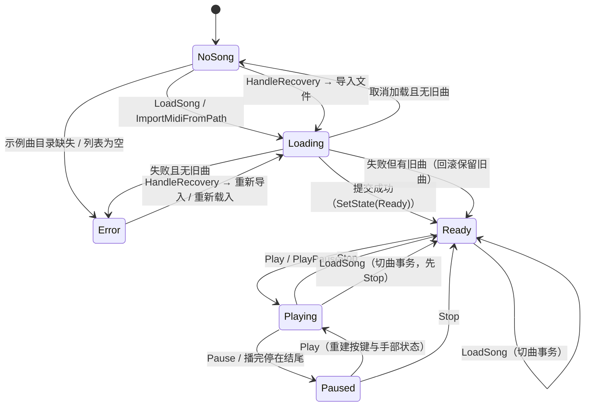
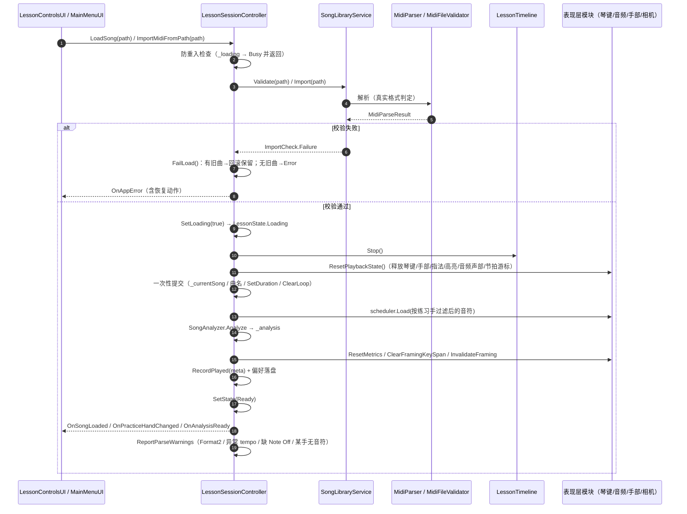

# 钢琴 3D 教学 APP — 系统架构设计

> 项目代号：Piano Teacher 3D
> 载体：Windows 桌面端（Unity 2022.3.22f1c1 + C#）
> 对应文档：方案 **9.1 保留核心门面，避免控制器无限膨胀**、**9.2 配置与内容分离**、**9.3 场景装配与测试**、**6.1 统一时间轴**、**6.2 状态机与切歌**
> 命名空间：`PianoTeacher3D.{Core, MIDI, Piano, Avatar, CameraControl, UI}`（注意是 `CameraControl`，避免与 `UnityEngine.Camera` 同名）

本文记录本轮改造后的真实架构。**只描述代码里已存在的类与方法**；尚未实现的接口在文中明确标注「计划中」。

---

## 1. 技术栈（锁定）

| 模块 | 实现 | 说明 |
|---|---|---|
| 引擎 | Unity 2022.3 LTS（`ProjectSettings/ProjectVersion.txt` 锁定 `2022.3.22f1c1`） | 首版 Windows 桌面端 |
| 语言 | C#（Unity 2022.3 对应 C# 9.0） | 脚本统一命名空间 `PianoTeacher3D.*` |
| 3D 人物 | 程序化人形 + 标准 Humanoid 骨架 + 程序化网格 | 零外部模型；`AvatarDefinition` 驱动 |
| 手部控制 | 自定义 IK + 可替换指法提供器 | 手腕目标与指尖目标分离求解 |
| 钢琴模型 | 程序化 88 键 + 立式琴体（倒角键身、黑键三层次、材质分层） | 零外部模型 |
| MIDI | 自研纯 C# `MidiParser` + `MidiFileValidator` | 不依赖 UnityEngine，可单测 |
| 音频 | `PianoAudioSynth` 波形合成 + `PianoVoiceAllocator` 受控声部池 | 零音频资产 |
| 测试 | Unity Test Framework（1.1.33） | EditMode + PlayMode |
| 版本管理 | Git | `.gitignore` 已排除 Library/Temp/构建输出 |

---

## 2. 铁律：统一时间轴（对应方案 6.1 / 13 取舍 2）

`LessonTimeline` 是**唯一权威播放时间来源**。音符调度、音频、琴键、手部、节拍器、进度条与预提示全部从它读取；
**任何模块不得自建计时器**。

| 时间概念 | 归属 | 说明 |
|---|---|---|
| **权威播放时间** | `LessonTimeline.CurrentTime` | 唯一时间源；由 `Update` 按 `Time.deltaTime × PlaybackSpeed` 推进 |
| **MIDI 事件时间** | `MidiParser` 解析结果 | 解析时把 tick 按 tempo map 换算为**秒制**；tempo map 只在解析层处理 |
| **音频时钟** | 不独立存在 | `PianoAudioSynth` 不推进时间轴；仅接收 Note On/Off 事件并发声 |
| **表现插值时间** | `CameraPoseTransition` / 各控制器 `Time.deltaTime` | 只用于平滑动画，**不反向修改**演奏时间 |

> 实现依据：`LessonTimeline` 只有 `Play / Pause / Stop / Seek / Restart / SetLoop / ClearLoop`，没有任何「按音频位置纠偏」或「自建计时」的入口；
> `Metronome.Tick(currentTime)` 与 `HandIKController.Tick(currentTime)` 的时间都由 `LessonSessionController.Update` 传入。

---

## 3. 模块拆分与职责边界（对应方案 9.1）

> 方案 9.1 提出的模块名与本文实际实现的对应关系：`AudioPlaybackService` → **`PianoAudioSynth`**（含 `PianoVoiceAllocator`）；
> `UIStatePresenter` → **`UIStatusBar` + `LessonControlsUI`**（职责由两个 UI 组件分担）。

| 方案组件 | 实现文件 | 状态 |
|---|---|---|
| `SongLibraryService` | `Core/SongLibraryService.cs` | 已支持 |
| `LessonSessionController` | `Core/LessonSessionController.cs` | 已支持（会话门面） |
| `LessonTimeline` | `Core/LessonTimeline.cs` | 已支持（唯一时间源） |
| `MidiParser` / `MidiEventScheduler` | `MIDI/MidiParser.cs`、`MIDI/MidiEventScheduler.cs` | 已支持 |
| `AudioPlaybackService` | `Piano/PianoAudioSynth.cs`（+ `PianoVoiceAllocator`） | 已支持 |
| `AvatarManager` | `Avatar/AvatarManager.cs` | 已支持 |
| `AvatarDefinition` | `Avatar/AvatarDefinition.cs` | 已支持（纯数据类） |
| `CameraModeController` | `Camera/CameraModeController.cs`（+ `Camera/CameraFraming.cs`） | 已支持 |
| `UIStatePresenter` | `UI/UIStatusBar.cs` + `UI/LessonControlsUI.cs` | 已支持 |
| `ErrorReporter` | `Core/ErrorReporter.cs`（+ `Core/AppError.cs`） | 已支持 |

### 3.1 `SongLibraryService`（曲库服务）

- **职责**：文件校验、复制到用户目录、曲目元数据、最近列表持久化、路径失效判断。**纯 C# 类**（不继承 MonoBehaviour、不依赖场景）。
- **公开接口要点**：
  - `ImportCheck Validate(string path)`、`ImportResult Import(string path)`
  - `IReadOnlyList<string> ListBuiltInSongs()`、`IReadOnlyList<SongMetadata> RecentSongs`
  - `bool TryResolve(SongMetadata, out string resolvedPath, out string problem)`、`bool TryResolveRecent(string idOrPath, out …)`
  - `void Forget(string id)`、`void ClearRecent()`、`void ClearCache()`、`void RecordPlayed(in SongMetadata)`、`void Save()/Load()`
  - `static string StableId(string sourcePath)`（FNV-1a 64，稳定且不含用户目录结构）
  - 目录：`BuiltInSongDirectory`（只读 `StreamingAssets/Songs`）、`UserSongDirectory`（`persistentDataPath/PianoTeacher3D/Songs`）
- **依赖方向**：依赖 `MIDI.MidiFileValidator`（校验）与 `Core`（`SongMetadata` / `AppError`）；**不依赖** UI、会话层、时间轴。
- **允许做**：读写文件、复制文件（仅限用户目录内）、生成安全 ID、容错（任何 IO 异常归类为 `ImportCheck`，不抛给调用方）。
- **不允许做**：不做 MIDI 解析算法（交给 `MidiParser` / `MidiFileValidator`）；不驱动 UI；不写回 `StreamingAssets`；不删除用户目录外的文件。

### 3.2 `LessonSessionController`（会话门面）

- **职责**：会话协调 + 公开命令。持有状态机（`LessonState`）+ 切曲事务 + 错误出口 + 偏好持久化 + 模块接线 + 场景装配。
- **公开接口要点**（节选）：
  - 状态 / 只读：`LessonState State`、`PlaybackState PlaybackState`、`CameraMode CameraMode`、`PracticeHand PracticeHand`、`SongAnalysis Analysis`、`HandMotionReport HandMotion`、`AppError LastError`、`IReadOnlyList<SongMetadata> RecentSongs`
  - 曲目：`void LoadSong(string path)`、`void ImportMidi()`、`void ImportMidiFromPath(string path)`、`bool TryOpenRecentSong(string idOrPath)`、`void CancelLoading()`
  - 播放：`PlayPause()`、`Play()`、`Pause()`、`Stop()`、`Restart()`、`Seek(float)`、`SeekNormalized(float)`、`SetSpeed(float)`
  - 表现：`CycleCameraMode()`、`SetCameraMode(CameraMode)`、`ReturnToCameraPreset()`、`ResetCamera()`、`CycleAvatar()`、`SwitchAvatar(int)`
  - 教学：`SetPracticeHand(PracticeHand)`、`SetLoop(float,float)`、`ToggleLoop()`、`SetMetronomeEnabled(bool)`、`SetHighlightMode(HighlightMode)`、`SetQualityTier(QualityTier)`
  - 错误：`HandleRecovery()`、`ClearLastError()`
  - 事件：`OnAppError` / `OnError` / `OnLessonStateChanged` / `OnSongLoaded` / `OnPlaybackStateChanged` / `OnProgressChanged` / `OnCameraModeChanged` / `OnPracticeHandChanged` / `OnHighlightModeChanged` / `OnMetronomeToggled` / `OnMetronomeBeat` / `OnAnalysisReady` / `OnAvatarChanged`
- **依赖方向**：单向向下依赖所有表现层模块与三个服务（`SongLibraryService` / `UserPreferences` / `ErrorReporter`）；UI 只依赖它，不反向。
- **允许做**：会话状态迁移、一次性提交新曲、统一错误出口、偏好读写、按帧驱动时间轴与各模块。
- **不允许做**：不实现 MIDI 解析细节、不直接操作相机 Transform、不直接搭建 UI 细节（交给各 UI 组件）、不让底层模块直接弹 UI。

### 3.3 `LessonTimeline`（唯一时间源）

- **职责**：推进权威播放时间；维护 `Stopped / Playing / Paused`；A-B 循环区间与跳回；`Seek` / `Restart`。
- **公开接口要点**：`PlaybackState State`、`float CurrentTime`、`float TotalDuration`、`float PlaybackSpeed`（clamp ≥ 0.1）、`bool IsLooping`、`float LoopStart/LoopEnd`、`SetDuration/SetLoop/ClearLoop/Play/Pause/Stop/Seek/Restart`、事件 `OnStateChanged` / `OnTimeChanged`。
- **依赖方向**：不依赖任何其它项目模块（仅 `UnityEngine`）；被会话层驱动。
- **允许做**：唯一推进时间；循环跳回时把 `CurrentTime` 设为 `LoopStart`。
- **不允许做**：不自建额外计时器；不感知曲目 / 音符 / 相机 / 音频（只暴露时间与状态）。

### 3.4 `MidiParser` + `MidiEventScheduler`（解析与调度）

- **`MidiParser` 职责**：纯 C# SMF 解析，输出秒制 `MidiNoteEvent`（`pitch / StartTime / Duration / Velocity / Track / Channel`）、`TempoChanges`、`TotalDurationSeconds`、`MidiFormat`、`Warnings`、`DanglingNoteCount`。
  - 支持 Format 0/1/2、PPQ 时间基（拒绝 SMPTE）、running status；Format 2 按轨道**顺序串接**并写 warning；极端 tempo（≤ 0 或 > 6,000,000 µs/四分音符）回落 120 BPM 并写 warning。
- **`MidiEventScheduler` 职责**：按统一时间推进 Note On/Off；区间查询 `CollectNotesInRange(from, to, buffer)`（供高亮与相机取景）；`SeekTo(t)` 重建 seek 点之前已开始的持续音。
- **依赖方向**：`MidiParser` 不依赖 UnityEngine；`MidiEventScheduler` 依赖 `MidiParser` 输出与 `PianoNoteFilter`。
- **允许做**：解析数据、调度事件、二分区间查询。
- **不允许做**：不发声、不动画、不改时间轴；不执行被导入文件中的任何命令或脚本（只解析 MIDI 数据）。

### 3.5 `PianoAudioSynth`（音频，对应方案 `AudioPlaybackService`）

- **职责**：受控发声池（24 声部 `AudioSource` + `PianoVoiceAllocator`）；音高采样一次性预生成；力度→音量（线性含底噪）+ 音色（声部低通截止频率随力度）；Note Off 在 0.12 s 内余弦淡出释放。
- **公开接口要点**：`bool Initialized`、`string LastInitError`、`int ActiveVoiceCount`、`bool Muted`、`void Initialize()`、`void OnNoteOn(MidiNoteEvent)`、`void OnNoteOff(MidiNoteEvent)`、`void ReleaseAll()`、`void SetMasterVolume(float)`。
- **依赖方向**：依赖 `MIDI.MidiNoteEvent` 与 `PianoKeyMap` 的音高范围常量；**不依赖**会话层/时间轴（时间由事件驱动）。
- **允许做**：分配 / 抢占声部、淡出释放、音量与音色映射、初始化失败降级静音。
- **不允许做**：不做任何每帧堆分配（`OnNoteOn/OnNoteOff/Update` 不 new List/数组/闭包）；不使用 `PlayOneShot`（无法停止）；不推进任何时间。

### 3.6 `AvatarManager`（角色资源生命周期与替换）

- **职责**：预生成 3 个程序化角色（`写实女性 / 写实男性 / 卡通`）；由 `AvatarDefinition` 驱动构建；构建后执行骨架校验并回退默认角色；切换只替换外观与手部引用。
- **公开接口要点**：`const int AvatarCount = 3`、`int CurrentIndex` / `string CurrentName` / `AvatarDefinition CurrentDefinition`、`Transform LeftShoulder/RightShoulder/LeftArm/RightArm`、`IHandRig LeftHand/RightHand`、`AvatarRigBuilder.Skeleton CurrentSkeleton`、`bool HasHumanoidRig`、`string LastRigValidationMessage`、`void BuildAvatars()`、`void SwitchAvatar(int)`、`void SwitchNext()`、事件 `OnAvatarChanged`。
- **依赖方向**：依赖 `AvatarRigBuilder`（骨架）、`AvatarDefinition` / `AvatarBodyMetrics`（尺寸与外观）；被会话层与相机层读取。
- **允许做**：构建 / 切换 / 校验 / 回退；通过 `IHandRig` 暴露手腕、掌心、手指根与指尖。
- **不允许做**：不改时间轴 / 播放进度 / 相机模式；不在构建失败时抛异常导致课程无法播放。

### 3.7 `AvatarDefinition`（角色资源定义，纯数据类）

- **职责**：描述模型标识、显示名、材质颜色、体型与原比例、发型、卡通标记、每角色 IK 偏移与质量配置；提供导入校验。
- **公开接口要点**：`string Id / DisplayName`、`UnityEngine.Avatar Avatar`、颜色字段、`float BodyHeight / BodyScale / HeadScale`、`int HairStyle`、`bool Cartoon`、`float HandHeightOffset / HandDepthOffset`、`AvatarQualityConfig Quality`、`AvatarPreset ToPreset()`、`static AvatarDefinition CreateDefault()`、`static string Validate(AvatarRigBuilder.Skeleton, AvatarDefinition)`。
- **依赖方向**：仅依赖 `UnityEngine` 与 `AvatarRigBuilder.Skeleton`；被 `AvatarManager` 使用。
- **允许做**：承载配置数据、执行纯静态校验（返回中文问题描述或 null）。
- **不允许做**：**不使用 ScriptableObject 资产文件**（见第 6 节取舍）；不持有 MonoBehaviour 引用；不实现构建逻辑。

### 3.8 `CameraModeController`（视角状态机，+ `CameraFraming`）

- **职责**：显式三状态机（`Closeup / Full / Free`）；每个模式独立的目标 / 姿态 / 裁剪面 / 阻尼 / 输入规则 / 返回策略；过渡中断以当前实际姿态为新起点。
- **公开接口要点**：`CameraMode Mode`、`string ModeLabel`、`bool IsTransitioning`、`CameraMode PreviousPreset`、`void Initialize(Camera, AvatarManager, PianoKeyMap)`、`void SetMode(CameraMode)` / `CycleMode()`、`void ResetView()`、`void ReturnToPreset()`、`void SetPracticeHand(PracticeHand)`、`void InvalidateFraming()`、`void SetFramingKeySpan(int,int)` / `ClearFramingKeySpan()`、`void SetMode` 相关。
  - `CameraFraming.cs` 提供纯数学策略 `FramingPolicy`（`SolveFraming` / `ComputeCloseupTarget` / `ComputeFullTarget` / `ShouldAcceptOrbitInput` 等）与数据结构 `CameraTarget / CameraPose / HandRegion / CloseupFramingTuning / FullFramingTuning / CameraPoseTransition / CameraModePreset`。
- **依赖方向**：读取 `AvatarManager`（手部 Transform 与包围盒）与 `PianoKeyMap`（键位）；被会话层驱动；`FramingPolicy` 不依赖场景，可 EditMode 单测。
- **允许做**：只改相机（位置 / 旋转 / FOV / 裁剪面）；计算取景；限幅与防穿。
- **不允许做**：不触碰 `LessonTimeline` / MIDI / 角色状态；`Update` 内不做 `GetComponentsInChildren` / LINQ / 字符串拼接 / 每帧组件查找。

### 3.9 `PianoSceneEnvironment`（场景环境）

- **职责**：地面 / 低干扰背景远景 / 受控装饰 / 三点光照（1 主光 + 补光 + 轮廓光）+ 键盘点光 / 接触阴影近似 / 内容包围盒 / 画质档位联动。
- **公开接口要点**：`Light MainLight/FillLight/RimLight/KeyLight`、`Bounds ContentBounds`、`QualityTier AppliedTier`、`void Build(PianoKeyMap, QualityProfile)`、`void ApplyQuality(QualityProfile)`、`void SetEnvironmentVisible(bool)`。
- **依赖方向**：依赖 `Core.QualityProfile` 与 `PianoKeyMap`；被会话层装配。
- **允许做**：创建环境几何与灯光；按档位调阴影质量；计算包围盒。
- **不允许做**：**不实现真实 AO / 后处理**（内置管线无后处理栈）——「接触阴影」是几何近似；不创建琴凳（`AvatarManager` 负责）/ 钢琴本体（`PianoKeyMap` 负责）/ 改相机背景色（会话层负责）；降档**不得**移除琴键高亮或补光。

### 3.10 `UIStatusBar` + `LessonControlsUI`（UI 展示层，对应方案 `UIStatePresenter`）

- **职责**：把应用状态转换为 UI 展示状态；**UI 不直接改写内部字段**，只调用会话层公开接口与订阅事件。
  - `UIStatusBar`：顶栏（返回曲库 / 曲库 / 曲名·状态 / 保存状态·帮助 / 当前人物）+ 错误横幅（含恢复按钮）+ 加载条（含取消）+ 轻量提示 + 浮层（曲库 / 帮助 / 确认弹窗）。
  - `LessonControlsUI`：3D 区轻量浮层 + 主播放栏 + 练习工具栏 + 分析面板（动作质量默认折叠在「开发诊断」区）+ 空状态。
  - 辅助控件：`UISegmentedControl`（分段选择器）、`UITooltip`（悬停提示）、`FileBrowserUI`（应用内文件选择器）、`AvatarSelectionUI`（角色面板）、`UITheme`（设计令牌与控件工厂）。
- **依赖方向**：只依赖 `LessonSessionController` 的公开接口与事件；控件工厂依赖 `UITheme` 令牌。
- **允许做**：渲染状态、提供恢复按钮入口、就近提示、响应式折叠、快捷键（作为补充入口）。
- **不允许做**：不直接读写 Core / MIDI / Piano / Avatar / Camera 模块的内部状态；不把关键信息只放进悬停提示；不只靠颜色区分状态；不在文本输入焦点下抢全局快捷键。

### 3.11 `ErrorReporter`（错误编码、日志与用户提示映射）

- **职责**：统一错误上报——脱敏 → 写日志（按严重程度选 `Log/LogWarning/LogError`）→ 更新 `Last` → 广播 `OnError`。
- **公开接口要点**：`AppError Last`、事件 `OnError`、`Func<LessonState> StateProvider`、`string Module`、`void Report(AppError)` / `Report(ErrorCode, ErrorSeverity, …)`、`void Clear()`；静态映射助手 `FromMidiFailure` / `NoSong` / `HandHasNoNotes` / `LoopRangeInvalid` / `Busy` / `AudioInitFailed` / `AvatarInvalid` / `FileMissing` / `TooComplex`。
- **依赖方向**：依赖 `AppError` 与 `PathSanitizer`（`Core`）；**不感知 UI**（UI 直接读 `AppError.UserMessage`）。
- **允许做**：只写日志与广播；默认不上传任何日志 / 曲目 / 照片，不做网络访问。
- **不允许做**：不弹 UI；不把堆栈写进用户文案；不记录完整个人文件路径（必须 `PathSanitizer.SanitizeMessage`）。

---

## 4. 会话状态机（方案 6.2）

`LessonState`（面向用户的整体状态）与 `PlaybackState`（时间轴内部时钟状态）分离：



- `LessonState.HasPlayableSong()`：`Ready / Playing / Paused` 为 true。
- `LessonState.BlocksSongActions()`：`NoSong / Loading / Error` 为 true（禁用「播放 / 重播 / 循环」等需要曲目的操作）。
- `SetLoading(true)` 在加载事务开始时进入 `Loading`；事务结束若仍处于 `Loading` 则按实际播放/曲目情况落回明确状态，**不覆盖**事务内已设置的终态。

---

## 5. 切曲事务（方案 6.2）



关键点：**任一步失败都回滚到明确状态**（有旧曲则保留旧曲，无旧曲则 `Error`），绝不出现「标题是新曲、音符仍是旧曲」的混合状态（方案 6.2 第 6 条）。

---

## 6. 配置与内容分离（方案 9.2）

方案 9.2 建议把速度档位、预提示提前量、相机参数、质量档位、默认角色与颜色集中到 `ScriptableObject` 配置。
**本轮的实际选择是：全部使用纯数据类 / 常量集中管理，未引入 `ScriptableObject` 资产文件。**

| 配置内容 | 当前承载 | 说明 |
|---|---|---|
| 产品默认值（速度 / 拍数 / 预提示 / 视角 / 练习手 / 高亮 / 质量档 / 上限与范围） | `Core/UserPreferences.Defaults` 内嵌静态类 | 集中一处，改动即同时影响加载与保存的 clamp |
| 画质档位 | `Core/QualityProfile`（`QualityTier` + 静态缓存实例 `StandardProfile` / `HighProfile`） | 设备判断的**唯一**判断点；`For()` 返回静态缓存，不每帧 new |
| 角色定义 | `Core`-同级 `Avatar/AvatarDefinition`（纯数据类）+ `AvatarBodyMetrics` 常量表 | 模型 / 材质 / IK 偏移 / 质量配置不写死在控制器里 |
| 场景环境数值 | `Piano/PianoSceneEnvironment` 私有常量区 | 几何 / 灯光 / 贴片数值集中 |
| 相机取景默认参数 | `Camera/CameraFraming`（`CloseupFramingTuning.Default()` / `FullFramingTuning.Default()`）+ `CameraModeController` Inspector 默认值 | 与 Inspector 默认值保持一致 |
| UI 设计令牌 | `UI/UITheme`（颜色 / 字号 / 间距 / 圆角 / 控件高度 / 布局令牌） | 所有 UI 脚本只引用令牌，不硬编码尺寸 |

**取舍理由（诚实说明）**：

- `ScriptableObject` 会引入 `.asset` 资产文件，与项目「零第三方资源、仓库轻量、可在 EditMode 测试里直接 `new`」的基线冲突：纯数据类可在单元测试里直接构造与断言，不需要 `.asset`。
- 纯数据类 + 静态常量的集中管理已经满足「同一常量不复制到多个脚本」的目标（有 `UIThemeTokenTests` / `QualityProfileTests` / `SceneEnvironmentTests` 等守护）。
- 未来若需要策划在编辑器里热调数值，可平滑迁移到 `ScriptableObject`：现有类的字段与默认值可 1:1 映射，公开接口不变。
- **用户偏好与产品默认值分开保存**：`UserPreferences`（用户数据，写 `persistentDataPath`）vs `UserPreferences.Defaults`（产品默认值）；用户数据**不写回** `StreamingAssets`（方案 9.2）。

---

## 7. 事件连线图（方案 4.3 数据流）

```mermaid
flowchart TD
    T[LessonTimeline<br/>唯一时间源] -->|每帧 CurrentTime| S[LessonSessionController]

    S -->|MidiEventScheduler.Tick| Sched[MidiEventScheduler]
    Sched -->|OnNoteOn| KA[PianoKeyAnimator]
    Sched -->|OnNoteOn / OnNoteOff| AU[PianoAudioSynth<br/>受控声部池]
    Sched -->|OnNoteOn / OnNoteOff| IK[HandIKController]
    Sched -->|OnNoteOn / OnNoteOff| FP[FingerPoseController<br/>IFingeringProvider]
    Sched -->|OnNoteOn / OnNoteOff| HL[PianoKeyHighlighter]

    S -->|CollectNotesInRange 二分| HL
    S -->|SetFramingKeySpan| CAM[CameraModeController]

    S -->|Tick currentTime| MT[Metronome]
    MT -->|OnBeat| S
    S -->|OnProgressChanged| UI[LessonControlsUI]
    S -->|OnAppError / OnError| SB[UIStatusBar]

    CAM -.->|只读取手部/包围盒| AV[AvatarManager]
    CAM -.->|只读键位| KM[PianoKeyMap]
    ENV[PianoSceneEnvironment] -.->|灯光/地面| CAM

    subgraph 服务层（纯 C#，不依赖场景）
        LIB[SongLibraryService]
        PRE[UserPreferences]
        REP[ErrorReporter]
    end
    S --> LIB
    S --> PRE
    S --> REP
```

说明：实线箭头为运行时每帧 / 事件驱动；虚线箭头为「只读引用」。相机、角色、环境**只改表现层，不触碰时间轴**。

---

## 8. 场景装配策略（方案 9.3）

`.unity` 场景仅包含：场景设置 + `Main Camera` + 装配入口对象（`PianoLesson` 场景挂 `LessonSessionController`，`MainMenu` 场景挂 `MainMenuUI`）。
钢琴、人物、环境、UI 等元素均由 `LessonSessionController.BuildScene()` 在运行时程序化生成：

1. 统一时间轴（`LessonTimeline`）+ 错误上报（`ErrorReporter`）+ MIDI 调度（`MidiEventScheduler`）。
2. 钢琴（`PianoKeyMap.BuildKeys()`，居中于 X）。
3. 教学场景环境（`PianoSceneEnvironment.Build(keyMap, quality)`）+ 关闭场景文件里遗留的灯光（避免两套阴影叠加）。
4. 琴键动画 / 音频 / 高亮 / 节拍器。
5. 人物（`AvatarManager.BuildAvatars()`，坐于 +Z 侧、面向 -Z 朝钢琴）。
6. 手部 IK + 手指姿态（指法走可替换提供器）。
7. 相机（`CameraModeController.Initialize`）+ 相机背景色 / 环境光。
8. UI（`LessonControlsUI` + `AvatarSelectionUI`；状态栏由控制栏内部装配）。
9. 事件连线（`OnNoteOn` / `OnNoteOff` 分别订阅各表现层模块）。

理由：符合方案「首版可先使用简化但比例准确的琴键模型」；避免手摆大量 GameObject 的 `.unity` 序列化脆弱性；装配逻辑集中在 C#，便于测试与版本管理。

---

## 9. 关键数据结构

- `MidiNoteEvent`（`MIDI/MidiNoteEvent.cs`）：`pitch / StartTime(秒) / Duration(秒) / Velocity / Track / Channel`。
- `MidiParseResult`（`MIDI/MidiParser.cs`）：`Success / Error / Notes / TotalDurationSeconds / Division / TrackCount / TempoChanges / MidiFormat / Warnings / DanglingNoteCount`。
- `TempoChange`（`MIDI/TempoChange.cs`）：秒制 tempo 变化点，首项恒为 t=0。
- `SongMetadata`（`Core/SongMetadata.cs`）：`Id / Title / SourcePath / DurationSeconds / NoteCount / TrackCount / TempoChangeCount / MidiFormat / FileSizeBytes / DanglingNoteCount / ImportedAtIso`。
- `AppError`（`Core/AppError.cs`）：`Code / Severity / UserMessage / Detail / Recovery / RecoveryLabel / Context`。
- `FingeringContext` / `FingeringPlan`（`Avatar/IFingeringProvider.cs`）。
- `HandMotionSample` / `HandMotionReport`（`Avatar/HandMotionMetrics.cs`）。

---

## 10. 测试策略（方案 8 / 11）

- **EditMode（278 条，纯逻辑，无 GPU）**：`MidiParser` 与 `MidiCompatibilityTests`、`MidiFileValidator`、`SongLibraryService`、`UserPreferences`、`PianoNoteFilter`、`TempoChange` / 拍点、`SongAnalyzer`、`HandPoseValidator`、`HandMotionAccumulator`、`CameraFraming`（`FramingPolicy` 数学）、`PianoMeshFactory` / `PianoKeyMap` 几何、`PianoVoiceAllocator`（音频释放）、`QualityProfile`、`PianoSceneEnvironment`、`UITheme` 令牌、`FingeringProvider`。
- **PlayMode（58 条，含 1 跳过）**：`LessonTimeline` 状态机、视角 / 角色切换不断流、**视角可用性 9 场景（`CameraVisibilityTests`，不依赖渲染）**、错误处理、教学功能（高亮 / 节拍器 / 分析）、动作质量、Humanoid 骨架、性能采样、压力 / 稳定性、视觉快照。
- **视觉**：`VisualSnapshotTests.CaptureLessonViews`（`[Category("Visual")]`，无图形设备时 `Assert.Ignore`），运行时自动生成 `Docs/screenshots/manifest.md`。
- **性能 / 稳定性**：`PerformanceSamplingTests`（`[Explicit]` + `[Category("Perf")]`）、`StressAndStabilityTests`（`[Category("Stress")]` / `Soak_PlaysContinuously` 为 `[Explicit]` + `[Category("Soak")]`），采样写入 `Docs/perf/`。

**踩坑记录**：`MaterialPropertyBlock` 等 Unity 原生对象**不可作为 MonoBehaviour 的字段初始化器**，必须惰性创建或在 `Awake` / `Initialize` 中创建。

---

## 11. 尚未实现 / 计划中的架构项

| 方案条目 | 状态 | 说明 |
|---|---|---|
| `IAvatarProvider`（预设 / 外观配置 / 导入模型） | 计划中 | 当前由 `AvatarManager` + `AvatarDefinition` 承担，未抽象为独立接口 |
| `IFingeringProvider`（启发式 / 人工 / 模型推断） | 已支持 | `IFingeringProvider` + `HeuristicFingeringProvider`，可替换 |
| `IHandMotionProvider`（基础 IK / 缓存动画 / AI 生成动作） | 计划中 | 手部动作目前由 `HandIKController` 直接实现，未抽出提供器 |
| `IAudioToScoreProvider`（音频转谱 + 置信度） | 计划中 | 方案 2.2 P2 / 第 10 章 |
| 真实采样音色替换波形合成 | 计划中 | 需先评估延迟 / 长音衰减 / 力度响应 / 同时发声数 / 许可条件（方案 7.3） |
| 移动端 / Web 输入命令抽象 | 计划中 | 方案 2.2 P2 / Sprint 5 |
| `ScriptableObject` 配置资产 | 计划中 | 当前用纯数据类，见第 6 节取舍 |
