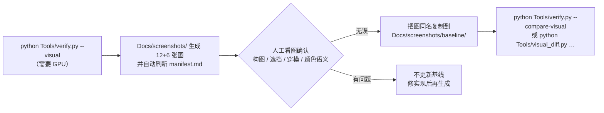

# 运行与验证指南（how-to-run.md）

> 项目：钢琴 3D 教学 APP（Piano Teacher 3D）
> 本文档说明**如何在本机把项目跑起来并验证结果**，分「一键命令行验证」「编辑器里体验」「GUI 测试」三种方式，
> 并给出全部 CLI 选项、产物位置、视觉基线维护流程与常见问题。
>
> 对应方案 **9.3 场景装配与测试**、**11.4 自动化与真实设备验证**、**12 分阶段路线图（Sprint 0 基线）**、**15 发布前检查清单**。

---

## 1. 环境依赖

| 依赖 | 版本 | 本机状态 | 说明 |
|---|---|---|---|
| Unity Editor | **2022.3.22f1c1**（revision `c3cbd310e76e`） | 已装：`D:\Unity\Unity 2022.3.22f1c1\` | 项目已锁定该版本（`ProjectSettings/ProjectVersion.txt`） |
| Unity Hub | 3.x | 已装 | 用于打开项目 |
| Python | 3.8+ | 已装 | 仅一键验证脚本需要，**无需 pip 安装任何包**（`verify.py`、`visual_diff.py` 均为纯标准库） |
| GPU（可选） | 支持渲染的显卡 | 已装：RTX 4060 笔记本 | 仅 `--visual` / `--compare-visual` 需要；其余阶段用 `-nographics` |

**无需安装的**：任何第三方 Unity 包、模型资源、音频素材——项目内所有资产均为程序化生成或 Unity 内置。

---

## 2. 项目结构（关键部分）

```text
piano-teacher-3d/
├── Assets/
│   ├── Scenes/                       # MainMenu.unity / PianoLesson.unity（运行时程序化装配）
│   ├── Scripts/                      # 46 个脚本，约 16,500 行
│   │   ├── Core/                     # 状态机 / 时间轴 / 会话门面 / 曲库 / 偏好 / 错误 / 画质
│   │   ├── MIDI/                     # 解析 / 校验 / 调度 / 过滤器
│   │   ├── Piano/                    # 琴键 / 动画 / 高亮 / 音频（声部池）/ 网格工厂 / 场景环境
│   │   ├── Avatar/                   # 人物 / 骨架 / 手部 IK / 指法提供器 / 动作指标
│   │   ├── Camera/                   # 视角状态机 + 取景数学
│   │   └── UI/                       # 设计令牌 / 控制栏 / 状态栏 / 分段选择器 / 文件选择器 ...
│   ├── StreamingAssets/Songs/        # demo.mid（内置示例曲，只读）
│   └── Tests/                        # 共 30 个测试文件（EditMode 17 + PlayMode 13）
├── Docs/
│   ├── architecture.md / animation-pipeline.md / ui-design-system.md / error-codes.md ...
│   ├── screenshots/                  # 视觉截图（运行时生成；含 baseline/ 子目录）
│   └── perf/                         # 性能采样与发布前环境矩阵（运行时/人工维护）
├── Tools/
│   ├── verify.py                     # 一键验证脚本
│   └── visual_diff.py                # 视觉基线像素比较工具
└── _verify_out/                      # 中间产物（日志与结果 XML，可随时删除）
```

> 用户数据（导入曲目副本、最近列表、偏好）在 **`Application.persistentDataPath/PianoTeacher3D/`**，不在仓库内。

---

## 3. 方式 A：一键命令行验证（推荐，最快）

在项目根目录执行：

```bash
python Tools/verify.py
```

`--help` 输出（与源码 `argparse` 一致）：

```text
usage: verify.py [-h] [--visual] [--edit-only] [--timeout TIMEOUT]
                 [--stress] [--soak] [--soak-seconds N] [--perf]
                 [--compare-visual] [--all]

Piano Teacher 3D 一键验证

options:
  -h, --help            show this help message and exit
  --visual              追加视觉基线截图（需要 GPU；该阶段不加 -nographics）
  --edit-only           只跑 EditMode
  --timeout TIMEOUT     单个阶段超时秒数（默认 420）
  --stress              追加压力与稳定性采样：-testCategory Stress（快速切换 / 资源加载 / 环境矩阵自检）
  --soak                追加长跑稳定性：-testCategory Soak（默认 600 秒，耗时长）
  --soak-seconds N      长跑时长（秒），通过环境变量 PT3D_SOAK_SECONDS 传给 Unity（默认 600）
  --perf                追加性能采样：-testCategory Perf（帧时间 p50/p95/p99 与 1% low FPS）
  --compare-visual      追加视觉基线比较：-testFilter CompareAgainstBaseline（需要 GPU 与人工确认的基线；
                        无基线时用例会 Ignore，脚本按「已跳过」如实报告）
  --all                 等价于 --visual --stress --perf（不含 --soak 与 --compare-visual）
```

### 3.1 各选项用途与耗时量级

| 选项 | 用途 | 阶段内部命令 | 耗时量级（本机 RTX 4060 笔记本） |
|---|---|---|---|
| （无参数） | 编译 + EditMode + PlayMode | `-quit` → `-runTests EditMode` → `-runTests PlayMode` | 约 3–4 分钟 |
| `--edit-only` | 只跑纯逻辑测试 | 跳过 PlayMode | 约 1 分钟 |
| `--visual` | 生成 12（V01–V12）+ 6 张保留截图 | `-runTests PlayMode -testFilter CaptureLessonViews`（**不加** `-nographics`） | 分钟级 |
| `--stress` | 快速切换 ≥ 200 次 / 资源加载采样 / 环境矩阵自检 | `-testCategory Stress` | 分钟级 |
| `--perf` | 帧时间 p50/p95/p99、1% low FPS、GC 分配 | `-testCategory Perf` | 分钟级 |
| `--soak` | 10 分钟以上连续播放稳定性 | `-testCategory Soak`（`PT3D_SOAK_SECONDS`） | 长跑时长 + 约 4 分钟 |
| `--compare-visual` | 与 `Docs/screenshots/baseline/` 逐张比较 | `-testFilter CompareAgainstBaseline`（**不加** `-nographics`） | 分钟级 |

### 3.2 执行顺序与退出码

脚本依次执行：**① 编译检查 → ② EditMode → ③ PlayMode →（可选）④ 视觉截图 → ⑤ 压力 → ⑥ 性能 → ⑦ 长跑 → ⑧ 视觉比较**，
最后打印「结果汇总」与「产物清单」。

| 退出码 | 含义 |
|---|---|
| `0` | 全部通过（含「如实跳过」的阶段） |
| `1` | 有失败项 |
| `2` | 环境问题（找不到 Unity Editor / 项目，或参数非法） |

> **诚实性**：某分类未匹配到任何用例、或全部用例被跳过时，脚本会打印 `⚠` 提示（`report_stage_special`），**不把「未执行」当「通过」**。

### 3.3 预期输出

```text
====================================================================
结果汇总
====================================================================
[EditMode] 通过 — 总计 278，通过 278，失败 0，跳过 0
[PlayMode] 通过 — 总计 74，通过 69，失败 0，跳过 5
    SKIP: CaptureLessonViews

--------------------------------------------------------------------
产物清单
--------------------------------------------------------------------
  ✓ Docs/screenshots/01_full.png  （最后修改 …）
  ✓ Docs/perf/sampling.md  （最后修改 …）
  …
```

> `CaptureLessonViews` 在无图形设备（`-nographics`）下会自动跳过——这是预期行为；
> 用 `--visual` 或在编辑器里跑即可生成截图。

---

## 4. 方式 B：在 Unity 编辑器里体验

1. 打开 **Unity Hub** → `Add project from disk` → 选择 `D:\WorkBuddy Project\钢琴3D教学\piano-teacher-3d`
   （版本已精确匹配 2022.3.22f1c1，不会提示版本不符）
2. 在 **Project 窗口**双击 `Assets/Scenes/MainMenu.unity`
3. 点顶部 **▶ Play**
4. 主菜单点曲目卡片 → 进入教学场景；或点「导入 MIDI…」用应用内文件选择器导入本地 `.mid` / `.midi`

### 4.1 操作说明

| 操作 | 方式 |
|---|---|
| 播放 / 暂停 | 主播放栏「播放」按钮 或 **空格** |
| 重新播放 | 主播放栏「重播」按钮 或 **[** |
| 视角切换 | 主播放栏「特写 / 全景 / 自由」分段选择器 |
| 自由观察 | 右键拖动旋转 + 滚轮缩放；**R** 回到标准构图 |
| 重置视角 | **R**（自由观察下回到进入前预设的标准构图） |
| 练习手 | 次级工具「练习手」分段（双手 | 左手 | 右手） |
| 速度 | 次级工具「速度」分段（0.5× | 1.0× | 1.5×） |
| 高亮提示 | 次级工具「高亮」分段 或 **H** |
| 循环 / A-B | 次级工具「循环」开关 +「设置 A / 设置 B / 清除 A-B」 |
| 节拍器 | 次级工具「节拍器」开关 或 **M** |
| 曲目分析 | 次级工具「曲目分析」 或 **Tab**（右侧面板；动作质量在「开发诊断」折叠区） |
| 角色 / 外观 | 顶栏「人物：xxx」或次级工具「角色 / 外观」 |
| 帮助面板 | 顶栏「帮助」 或 **F1** |
| 关闭浮层 / 取消确认 | **Esc** |
| 拖动进度 | 拖进度条（有圆形手柄与 A/B 标记） |

### 4.2 建议验证点（对应方案 11.3 / 审查 6.2）

1. **播放中切换视角 / 角色 / 分手 / 高亮**：音乐与进度**不中断、不重置**；
2. **手部特写**：能同时看清活动手、主要指尖与相应琴键；
3. **全景**：能看清人物坐姿、肩臂与完整键盘（低音端不再被琴体遮挡）；
4. **曲目分析面板**（Tab）：展开「开发诊断」查看命中率 / 最大帧位移 / 平滑度 / 双手协调 / 穿模告警；
5. **节拍器**（M）：次级工具出现拍点圆点，强拍闪烁（实心点）；
6. **导入 + 最近曲目**：导入一个本地 MIDI，返回主菜单后可在「最近播放」再次打开；手动删掉文件后应提示「文件缺失」。

---

## 5. 方式 C：Unity Test Runner（GUI 跑测试）

1. Unity 编辑器 → 菜单 `Window > General > Test Runner`
2. **EditMode** 标签页 → `Run All`（纯逻辑测试，秒级）
3. **PlayMode** 标签页 → `Run All`（运行时测试，约 1–2 分钟）
4. 绿色 = 通过；点击失败项可看到断言消息

> `[Explicit]` 标注的用例（性能 / 长跑 / 基线比较）默认**不会**在 `Run All` 中执行；需要在 Test Runner 里选中其 `Category`
> （`Perf` / `Soak` / `Visual`）或直接跑对应测试，或使用 `python Tools/verify.py --perf` / `--soak` / `--compare-visual`。

---

## 6. 产物说明

### 6.1 `Docs/screenshots/`（视觉截图）

| 内容 | 说明 |
|---|---|
| `01_full.png` … `06_avatar_cartoon.png` | 保留的 6 张既有基线（方案 11.2 部分场景） |
| `V01_*.png` … `V12_*.png` | 12 张截图用例（审查 6.1 V01–V09 + 方案 11.2 补充的 V10–V12） |
| `manifest.md` | **由 `VisualSnapshotTests.CaptureLessonViews` 运行时自动生成/覆盖**，列出每张图的角色 / 曲目 / 播放时间 / 相机状态 / 窗口尺寸 / 检查要点 |
| `baseline/` | **经人工看图确认无误**的基线图（同名），用于自动像素比较；空目录时比对用例会 `Assert.Ignore` |

- 生成：`python Tools/verify.py --visual`（需要 GPU，脚本该阶段**不加** `-nographics`）。
- 清单与观察要点见 [`Docs/visual-regression.md`](visual-regression.md) 与 `Docs/screenshots/manifest.md`。

### 6.2 `Docs/perf/`（性能与环境记录）

| 文件 | 内容 | 谁写 |
|---|---|---|
| `sampling.md` | 帧时间采样（平均 / p50 / p95 / p99 / 最大、平均 FPS、1% low FPS、GC 增量）、切换负载、长跑稳定性、资源加载采样的「小节」 | `PerformanceSamplingTests` / `StressAndStabilityTests` 运行时写入（勿手工改小节） |
| `environments.md` | 发布前环境矩阵（无网络 / 中文与空格路径 / 非管理员 / 不同 DPI / 窄窗口 / 集显与中档独显）；含「本机自检」小节 | 本机自检小节由 `EnvironmentMatrixChecklistTests` 写入；其余为**人工记录区**（未实测项保留「待测」） |

> **诚实性声明**：批处理（`-batchmode`）与无图形设备（`-nographics`）下采集的帧率 / 帧时间**不含渲染负载，不能代表真实设备体验**；
> 未在目标电脑上采集的数据不得写成「已达标」（方案 11.3 / 11.4）。

---

## 7. 视觉基线的生成 / 更新流程

> 原则（方案 11.2 末段 / 审查 6.1）：「**像素差异只作辅助，不能替代人工看图**」；**更新基线必须人工确认**。



步骤：

1. **生成**：在有 GPU 的机器上跑 `python Tools/verify.py --visual`（或直跑
   `Unity.exe -batchmode -runTests -testPlatform PlayMode -testFilter CaptureLessonViews`，**不要**加 `-nographics`）。
2. **人工看图**：确认构图、遮挡、穿模与颜色语义无误（这一步**不可省略**）。
3. **更新基线**：把确认无误的图以**同名**复制到 `Docs/screenshots/baseline/`，再提交 `baseline/` 与 `manifest.md`。
4. **自动比对**：之后可用 `python Tools/verify.py --compare-visual`（只跑基线比较用例），
   或直接跑 `python Tools/visual_diff.py Docs/screenshots/baseline Docs/screenshots` 做辅助比较。

---

## 8. `Tools/visual_diff.py` 用法与退出码

纯标准库 PNG 比较工具（不需要 numpy / Pillow）。只支持 **8 位、非隔行、color type 2(RGB)/6(RGBA)** 的 PNG
（Unity `Texture2D.EncodeToPNG()` 输出即属此列）；其余格式明确报错，不做猜测。

```bash
python Tools/visual_diff.py Docs/screenshots/baseline Docs/screenshots
python Tools/visual_diff.py Docs/screenshots/baseline Docs/screenshots --tolerance 8
python Tools/visual_diff.py Docs/screenshots/baseline Docs/screenshots \
    --roi 320,180,640,360 --exclude-roi 0,600,1280,120 --max-diff-ratio 0.01
python Tools/visual_diff.py Docs/screenshots/baseline Docs/screenshots --json _verify_out/visual_diff.json
```

| 选项 | 含义 |
|---|---|
| `--tolerance N` | 逐像素容差（0–255，默认 6）：比较 RGB 三通道的**平均绝对差**，超过即判定该像素「超差」 |
| `--roi x,y,w,h` | 只比较该矩形区域，可重复（多个 ROI 取并集） |
| `--exclude-roi x,y,w,h` | 排除该矩形区域，可重复（在 ROI 之后生效） |
| `--max-diff-ratio R` | 允许的超差像素比例（0–1，默认 0.02）；超差比例 ≤ R 即通过 |
| `--json PATH` | 把机器可读结果写入该文件 |
| `--max-images N` | 只比较排序后的前 N 张（调试用，默认 0 = 全部） |
| `--quiet` | 不打印逐张明细（仍打印汇总） |

**坐标约定**：ROI 使用图像坐标（原点在左上角，x 向右、y 向下，与 PNG 存储一致）。

| 退出码 | 含义 |
|---|---|
| `0` | 全部通过 |
| `1` | 存在超差图片 |
| `2` | 环境问题（基线/当前目录缺失、同名文件缺失、PNG 格式不支持或解码失败、参数非法）；同时存在超差与环境问题时以 `2` 优先 |

---

## 9. 预期结果一览（本轮基线）

| 指标 | 预期值 | 来源 |
|---|---|---|
| 编译 | 0 错误 0 警告 | `Tools/verify.py` |
| EditMode 测试 | **278 / 278 通过** | `_verify_out/editmode2.xml` |
| PlayMode 测试 | **69 通过 + 5 跳过 + 0 失败**（总计 74） | `_verify_out/playmode.xml` |
| Humanoid 骨架 | `avatar.isValid && avatar.isHuman == true`（3 个角色） | `HumanoidSceneTests` |
| 动作质量 | 命中率 **93.6%** / 最大帧位移 **35 mm** / 穿模 **0**（口径见 [`Docs/animation-pipeline.md`](animation-pipeline.md) 第 6 节） | `HandMotionTests` |
| 播放帧率（逻辑层） | 无渲染负载下的采样（不代表真实设备体验） | `PerformanceTests` / `PerformanceSamplingTests` |

> 说明：改造前基线为 EditMode 96 / PlayMode 58（见 `_verify_out/editmode.xml`）。

---

## 10. 常见问题

| 现象 | 原因与处理 |
|---|---|
| `verify.py` 报「未找到 Unity Editor」 | 安装路径不同时，设置环境变量：`set UNITY_PATH=D:\你的路径\Unity.exe` |
| 测试阶段显示「(Unity 未退出，但结果已生成)」 | Unity 已知行为（`-runTests` 后偶发卡在退出阶段）；脚本按「结果文件生成即继续」处理，结果有效 |
| PlayMode 里 `CaptureLessonViews` 被跳过 | **无图形设备时自动跳过**（预期行为）；用 `--visual` 或编辑器里跑即可生成截图 |
| `--visual` / `--compare-visual` 报错或截图全黑 | 这两个阶段需要真实 GPU，请**不要**给它们加 `-nographics`（`verify.py` 已自动处理）；确认机器有可用显卡 |
| `--compare-visual` 全被跳过 | 说明 `Docs/screenshots/baseline/` 为空——先按第 7 节流程生成并**人工确认**基线 |
| `--soak` 跑很久 | 长跑默认 600 秒（10 分钟），是设计如此；调试时用 `--soak --soak-seconds 120` |
| 测试里我的用户偏好没生效 | **`-batchmode` 下故意不套用用户偏好**，保证用例确定性（见 README 3.7 / `LessonSessionController.ApplyPreferences`） |
| 编辑器打开时提示版本不符 | 确认安装的是 **2022.3.22f1c1**（中国版），`ProjectVersion.txt` 已锁定该版本 |
| 画面里看不到人物手部 | 用「视角」分段切到**手部特写**；全景下手在键盘上方 |
| 导入后「最近播放」提示文件缺失 | 源文件被移动/删除属正常提示；点「导入 MIDI…」重新选择，或从最近列表移除该记录 |
| Unity 在 `-runTests` 后挂起不退出 | 已由 `verify.py` 处理（结果 XML 生成即继续）；用编辑器 Test Runner 时属 Unity 已知行为，手动结束进程即可 |

---

## 11. 测试跳过项与发布门禁（2026-10-19 核对）

对应优化方案 §7 清单第 2 项「整理测试跳过项并定义发布门禁」。
本轮 `python Tools/verify.py` 实测：**EditMode 314/314 通过；PlayMode 95 通过、5 跳过、0 失败**（`_verify_out/playmode.xml`）。
跳过的 5 项**全部是环境/显式配置跳过，不是失败**，逐项说明如下：

| 跳过用例 | 跳过原因 | 补跑路径 |
|---|---|---|
| `PerformanceSamplingTests.SampleFrameTiming` | `[Category("Perf")]` 显式类别，默认「全部测试」不执行 | `python Tools/verify.py --perf` |
| `PerformanceSamplingTests.SampleFrameTiming_UnderSwitchingLoad` | 同上（切换负载采样） | `python Tools/verify.py --perf` |
| `StressAndStabilityTests.Soak_PlaysContinuously` | `[Category("Soak")]` 显式类别，默认 10 分钟不随常规验证跑 | `python Tools/verify.py --soak`（调试可用 `--soak --soak-seconds 120`） |
| `VisualBaselineCompareTests.CompareAgainstBaseline` | 需要真实 GPU 与已确认的基线图；`-nographics` 下跳过 | `python Tools/verify.py --compare-visual` |
| `VisualSnapshotTests.CaptureLessonViews` | 无图形设备时跳过（截图不可能产出） | `python Tools/verify.py --visual` |

### 11.1 门禁分层（建议）

| 层 | 触发 | 内容 | 通过标准 |
|---|---|---|---|
| PR 快速门禁 | 每次提交 | 编译 + EditMode + 关键 PlayMode | 0 编译错误；EditMode 全通过；无新增失败 |
| 主分支 | 合并到 master | 完整 PlayMode | 跳过项必须在本表登记原因；跳过≠通过 |
| 夜间 / 候选发布 | 定时或发版前 | `--visual --compare-visual --stress --perf` + Windows Player 冒烟 + 10 分钟 Soak | 截图差异需人工审阅后才能更新基线；Player 冒烟覆盖主菜单、加载 `demo.mid`、播放/暂停/恢复、切视角/角色、退出清理 |
| 发布候选 | 发版前 | 30 分钟 Soak + 干净检出构建 | 资源数量无单调增长；错误降级路径可用 |

> 边界说明：`--perf` / `--soak` / `--visual` 跑的是 **Editor** 内的玩家循环，**不能**替代真实 Windows Player 的帧时间与内存结论。
> 后者用 `python Tools/verify.py --player` 单独采集（见 11.2）；两层数据分开记录在 `Docs/perf/sampling.md` 的不同小节。

### 11.2 门禁命令（2026-10-19 新增）

| 目的 | 命令 | 说明 |
|---|---|---|
| 静态检查（无需 Unity） | `python Tools/static_checks.py` | 纯 C# 模块不得引用 UnityEngine、UI 不得直连调度器/时间轴、禁止空 catch；并扫描 TMPro / Timeline / Animation Rigging 的引用数（信息性，不自动删包） |
| 真实 Player 基线 | `python Tools/verify.py --player [--player-seconds 20]` | Development Build（仅 `PianoLesson` 场景）→ 独立进程采样 `play` / `switch` 两个场景 → 写入 `Docs/perf/sampling.md` 的 `player-*` 小节与 `Docs/perf/environments.md` |
| CI | `.github/workflows/verify.yml` | `static` job 跑在 GitHub 托管 runner（无需 Unity）；`unity` job 需要注册 `[self-hosted, windows, unity]` 标签的机器 |

> `--player` 需要**图形设备**：在无 GPU/无桌面的环境会构建失败或采不到数据，脚本会如实报告而不会用 Editor 数据顶替。
