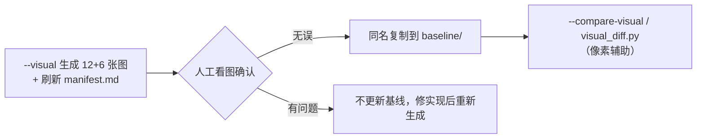

# 视觉回归与视角可用性测试（visual-regression.md）

> 对应方案 **11.2 视觉回归**、**11.4 自动化与真实设备验证**、**15 发布前检查清单**；审查 **3.2 视角可用性**、**6.1 画面基线组合**、**6.2 相机验收清单**。
> 实现位置：`Assets/Tests/PlayMode/VisualSnapshotTests.cs`（`CaptureLessonViews`）、`Assets/Tests/PlayMode/VisualBaselineCompareTests.cs`（`[Explicit]`）、
> `Assets/Tests/PlayMode/CameraVisibilityTests.cs`、`Tools/visual_diff.py`。
> 截图清单：`Docs/screenshots/manifest.md`（**由测试运行自动生成/覆盖，勿手工编辑**）。

---

## 0. 两条铁律（务必遵守）

1. **像素差异只作辅助，不能替代人工看图**（方案 11.2 末段 / 审查 6.1）。
   光照、材质、抗锯齿与显卡驱动的细微变化都会让同一构图的像素值改变；自动比对必须配合 `--tolerance` / `--roi` 使用。
2. **更新基线需人工确认**：只有**经人工看图确认无误**的图才能复制进 `Docs/screenshots/baseline/`；缺基线时比对用例 `Assert.Ignore`，**不会**把当前截图自动当基线。

---

## 表一：截图用例（V01–V12 + 保留的 6 张）

> 由 `VisualSnapshotTests.CaptureLessonViews`（`[Category("Visual")]`）生成；固定窗口 **1280×720**、锁定 Unity **2022.3.22f1c1**。
> 「运行时列」（角色 / 曲目 / 播放时间 / 相机状态 / 窗口尺寸 / Unity 版本）会在第一次实际采集后写入 `Docs/screenshots/manifest.md`。

| 文件 | 编号 | 场景 | 检查要点 | 对应文档条目 |
|---|---|---|---|---|
| `01_full.png` | （保留） | 标准全景 | 键盘完整、低音端无遮挡、人物完整入画 | 方案 11.2-2 |
| `02_closeup.png` | （保留） | 手部特写（白键旋律） | 掌心、指尖与相应琴键同时可见 | 方案 11.2-3 |
| `03_playing.png` | （保留） | 播放中全景 | 琴键动作与高亮同步、人物无穿模 | 方案 11.2-2 |
| `04_practice_left.png` | （保留） | 分手练习开启 | 相机聚焦活动手 | 方案 11.2-6 |
| `05_avatar_man.png` | （保留） | 切换至写实男性后同一机位 | 构图规律一致 | 方案 11.2-8 |
| `06_avatar_cartoon.png` | （保留） | 切换至卡通角色后同一机位 | 构图规律一致、风格适配 | 方案 11.2-8 |
| `V01_closeup_chord.png` | V01 | 写实女性 · 手部特写 · 双手中音区和弦 | 掌心、指尖、琴键可见；指法自然 | 审查 6.1 V01 / 方案 11.2-4 |
| `V02_closeup_wide_leap.png` | V02 | 手部特写 · 低音到高音大跨度跳跃 | 动态取景范围与阻尼：两手分开时画面不突然缩放 | 审查 6.1 V02 / 3.2-1 |
| `V03_full_arm_motion.png` | V03 | 写实男性 · 全景 · 手臂运动明显片段 | 坐姿、肩臂、完整键盘 | 审查 6.1 V03 |
| `V04_full_cartoon.png` | V04 | 卡通角色 · 全景 · 中等速度片段 | 风格一致与取景适配 | 审查 6.1 V04 |
| `V05_left_hand_only.png` | V05 | 左手练习特写 | 相机聚焦活动手 | 审查 6.1 V05 / 3.2-3 |
| `V06_right_hand_only.png` | V06 | 右手练习特写 | 相机聚焦活动手 | 审查 6.1 V06 / 3.2-4 |
| `V07_free_orbit_paused.png` | V07 | 自由观察（暂停态） | 旋转 / 缩放、UI 鼠标操作边界 | 审查 6.1 V07 |
| `V08_switch_settled.png` | V08 | 播放中连续切换视角后 | 最终构图稳定、时间轴连续 | 审查 6.1 V08 |
| `V09_closeup_loop.png` | V09 | A-B 循环跳转后构图 | 循环跳转后手位和相机不追旧目标 | 审查 6.1 V09 |
| `V10_mainmenu.png` | V10 | 主菜单 / 空曲库 | 导入入口可见；无曲目时不显示可播放按钮 | 方案 11.2-1 |
| `V11_highlight_on.png` | V11 | 高亮提示开启 | 颜色语义正确（暖金=预提示、左蓝/右橙=发声），且高亮不遮挡手部 | 方案 11.2-5 |
| `V12_analysis_expanded.png` | V12 | 曲目分析面板 + 开发诊断展开 | 分析面板展开；动作质量默认折叠在「开发诊断」区 | 方案 11.2-7 |

> 说明：`manifest.md` 中还列入方案 11.2 的其余场景（窄窗口 / 高 DPI 等）；其 12 张自动用例与 6 张保留基线共同构成当前截图矩阵。
> 生成命令见第 3 节与 [`how-to-run.md`](how-to-run.md) 第 7 节。

---

## 表二：视角可用性测试（`CameraVisibilityTests`）——审查 3.2 的 9 个必测场景

`CameraVisibilityTests` **不依赖渲染**（全部断言基于 `Camera.WorldToViewportPoint` 投影数学与 `HandIKController` 目标状态），
因此在 `-nographics`（无图形设备）下同样执行，**不会像 `VisualSnapshotTests` 那样被跳过**。

| # | 测试方法 | 场景（审查 3.2） | 断言与阈值 |
|---|---|---|---|
| 1 | `Scene1_WideLeap_BothHandsStayFramed` | 双手相距很远的低音—高音跳跃段 | 双手手腕 / 掌心投影落在 `[0.05, 0.95]`（`HandCoreMargin`）；指根次级点落在 `[0.03, 0.97]`（`HandFingerMargin`）；临近琴键键根落在 `[0.02, 0.98]`（`CloseupKeyMargin`） |
| 2 | `Scene2_MiddleChord_HandsKeysAndUiAllClear` | 双手集中在中音区的和弦段 | 手核心点 / 琴键均在安全视口内；对照底部 UI 预留区，手部**不被控制栏遮挡** |
| 3 | `Scene3_LeftHandOnly_CameraFocusesLeftHand` | 只有左手有音符 | 左手为取景主手（主手宽度占比 ≥ `PrimaryShare` = 0.7）；左手核心点安全，次手尽量保留可见 |
| 4 | `Scene4_RightHandOnly_CameraFocusesRightHand` | 只有右手有音符 | 同 3，方向相反 |
| 5 | `Scene5_FastScale_NoSuddenZoom` | 连续快速音阶 | 相机距离单帧变化 ≤ `MaxDistanceStepPerFrame`（0.15 m/帧，低帧率按 `MaxDistanceRate`=6 m/s 与 `MaxDistanceStepLowFps`=0.6 m/帧 放宽）；FOV 单帧变化 ≤ `MaxFovStepPerFrame`（8°/帧，低帧率放宽至 `MaxFovStepLowFps`=24°/帧 与 `MaxFovRate`=60°/s） |
| 6 | `Scene6_PauseThenSwitchViewThenResume_RecomputesHandTargets` | 暂停后切换视角再继续 | 恢复后按当前时间轴**重算**手部目标（不追旧目标）；无持续相机抖动 |
| 7 | `Scene7_SeekToMiddle_ConvergesWithHandsAndKeysVisible` | 拖动进度条至曲目中段 | 相机**收敛**（连续两帧位置变化 < `ConvergePositionEpsilon` = 0.002 m）；手与琴键可见 |
| 8 | `Scene8_LoopBoundary_ReturnsToAAndConverges` | A-B 循环边界 | 跳回 A 点后重新收敛；手位与相机不追旧目标 |
| 9 | `Scene9_ThreeAvatars_X_TwoViews_AllFullyFramed` | 三种角色分别处于手部特写和全景 | 特写：手 / 键在安全视口内；全景：琴键两端（A0/C8）与人物包围盒落在 `[0.0, 1.0]`（`FullViewMargin`），人物头脚不出框 |

> 阈值来源说明：审查 3.2 只给了**观察标准**（「是否同时可见」「是否被遮挡」「是否突然缩放」），
> 本测试把这些标准**量化为阈值**，并在每条断言消息里带上实际值与阈值，便于回归时快速定位。

### 观察标准（人工核对，对应审查 3.2 / 6.2）

- 活动手掌、主要指尖与对应琴键是否**同时可见**；
- 手部是否被 UI、琴体或画面边缘**遮挡**；
- 两手跨度变化时画面是否**突然缩放**；
- 全景是否能看到**完整键盘与必要演奏姿态**（低音端不再持续遮挡）；
- 切换动画是否产生明显穿过钢琴、绕远路或最终角度不一致；
- 摄像机表现是否随角色身材改变而**失衡**。

---

## 3. 操作流程

### 3.1 生成截图

```bash
python Tools/verify.py --visual
```

- 该阶段脚本**不加** `-nographics`（需要真实 GPU）；内部命令为
  `Unity.exe -batchmode -runTests -testPlatform PlayMode -testFilter CaptureLessonViews`。
- 生成后 `Docs/screenshots/` 下出现 12 + 6 张 PNG，并自动刷新 `Docs/screenshots/manifest.md`。
- 无 GPU 时该用例以 `Assert.Ignore` 结束，**不会伪造通过**。

### 3.2 人工看图确认

对照表一的「检查要点」逐个核对：**关键 UI 不遮挡演奏区域、手部没有明显穿模、角色未被裁切、颜色语义正确**（方案 11.2 末段）。
这一步**不可省略**。

### 3.3 更新基线

把确认无误的图以**同名**复制到 `Docs/screenshots/baseline/`（覆盖旧基线），再提交 `baseline/` 与 `manifest.md`。

```text
Docs/screenshots/baseline/   ← 经人工确认的基线图（同名）
Docs/screenshots/            ← 本次运行生成的当前图
```

### 3.4 自动像素比较（辅助）

两种方式，二选一：

```bash
python Tools/verify.py --compare-visual       # 只跑基线比较用例（需要 GPU 与人工确认的基线）
python Tools/visual_diff.py Docs/screenshots/baseline Docs/screenshots \
    --tolerance 8 --roi 320,180,640,360 --exclude-roi 0,600,1280,120 --max-diff-ratio 0.01
```

- `visual_diff.py` 支持 `--tolerance` / `--roi` / `--exclude-roi` / `--max-diff-ratio` / `--json`；
  退出码 `0` 通过 / `1` 存在超差 / `2` 环境问题（详见 [`how-to-run.md`](how-to-run.md) 第 8 节）。
- **缺基线时比对用例 `Assert.Ignore`**，脚本按「已跳过」如实报告。
- 像素通过**不代表画面对**——仍需人工看图。

### 3.5 完整流程图



---

## 4. 与其它文档的关系

- 截图清单的权威来源是 `Docs/screenshots/manifest.md`（**自动生成，勿手工编辑**）。
- 视觉相关的人工验收清单见 [`Docs/completion-review.md`](completion-review.md)（方案 15 章 / 审查 6.2 逐条）。
- 相机状态机与取景规则见 [`Docs/architecture.md`](architecture.md)；手指落键与指标口径见 [`Docs/animation-pipeline.md`](animation-pipeline.md)。
- 运行命令与产物目录见 [`Docs/how-to-run.md`](how-to-run.md)。

---

## 5. 人工看图发现的问题与修复记录

> 建立本节的理由：方案 9.3 明确「自动测试判断逻辑正确性；截图基线 / 人工评审判断视觉质量。
> **不要让逻辑单测替代视觉验收**」。下面这条就是「数据全绿、画面却是错的」的实例。

### 5.1 手部特写被角色头部遮挡（2026-10-16 发现并修复）

- **现象**：手部特写（`Closeup`）在中音区演奏时，画面正中是一大团头发，键面与双手被挡在后面。
- **为什么自动测试没发现**：`CameraVisibilityTests` 原本只断言「活动手 / 琴键的投影点落在视口内」。
  投影点确实在视口内 —— 它只是**被头部挡住了**，属于遮挡问题而非取景范围问题。
- **根因（几何）**：相机位置 = 焦点 + `d·(sinθ, cosθ)`。角色头部位于键盘后方 `z≈0.42m`、高约 `1.09–1.19m`。
  当水平后移量 `d·cosθ` 超过「焦点到头部的水平距离」（≈0.46m）时，头部必然落在相机 → 双手的连线上。
  原参数 `CloseupViewPitch = 34°` 时 `cos34° ≈ 0.83`，只要距离超过 `0.55m` 就会遮挡；
  而大跨度双手又必须靠拉远到 `0.75m+` 才能框住 → **必然发生**。
- **修复**：`CloseupViewPitch` 由 `34°` 改为 **60°**（`cos60° = 0.5`，即使取到最大距离 `0.88m` 也有 `d·cosθ = 0.44 < 0.46`），
  从几何上排除遮挡；同时把 `CloseupMaxDistance` 由 `0.75m` 放宽到 `0.88m`、`CloseupMaxFov` 由 `44°` 放宽到 `48°`，
  以在**窄窗口（4:3）**下仍能框住大跨度双手（上限仍是有界预设，动态变化依旧受 `RateLimit` 限速）。
- **防回归**：`CameraVisibilityTests` 新增 `AssertHeadNotOccludingHands` ——
  计算「头到相机→双手连线的最短距离」，要求 `> 0.10m`（头部半径量级）。这是纯几何判定，与截图无关，
  因此能在 `-nographics` 下持续守护。
- **同类提醒**：涉及「是否被遮挡」的问题（手被头部 / 琴体 / UI 面板挡住）**必须**用几何或像素手段显式检查，
  不能只看投影点是否落在视口内。

### 5.2 手部「连指手套」观感 + 腕部凸环（2026-10-18 发现并修复）

- **现象（改造前，旧基线 `02_closeup.png`）**：手部特写里的手像一只连指手套 —— 掌部是一团圆球，
  五指只在末端露出几根短桩；手腕处有一圈明显的凸环，手臂比手掌还粗。
- **为什么自动测试没发现**：`HandFingerCorrespondenceTests` 断言的是「被分配指尖到键面的距离」，
  数值达标（3–32 mm）不等于手看起来像手；网格是「多个椭球并集」，投影上就是一坨。
- **根因**：
  ① 掌部由 `PalmRoot` / `PalmCore` / `KnuckleRidge` / `Thenar` / `Hypothenar` 五块椭球拼接，轮廓是它们的并集；
  ② 手指虽然有三段胶囊，但只有指根一个自由度，且指根朝向被"对准琴键"带着向后翻转；
  ③ `ArmRadius = 0.048`（直径 96 mm）**大于**掌宽 76 mm，手掌等于插进一根粗圆柱。
- **修复**：
  ① 新增 `HandMeshFactory`：掌部改为**单块超椭圆截面放样**（宽度 0.78→1.00→0.94、厚度 0.86→1.00→0.80，
  大鱼际/小鱼际作为轮廓隆起），手指逐段渐缩 + 半圆指尖，高精度档加指甲；
  ② 每指升级为 MCP/PIP/DIP 三关节，指根朝向由手掌决定（俯角 10°–36°），关节用铰链轴 CCD 送到键面；
  ③ `ArmRadius` 0.048 → **0.036**、掌长 0.058 → **0.066**、腕部过渡体缩小到掌根截面以内。
- **人工确认（2026-10-18 22:56–23:01）**：逐张查看 `V05_left_hand_only.png`、`V01_closeup_chord.png`，
  确认：五指可分辨、指尖圆头、掌根到手臂过渡连续、腕部凸环消失；`01_full.png` / `03_playing.png` 的
  人物与钢琴构图与旧基线一致（无回归）。
- **基线更新**：`Docs/screenshots/*.png` 已按上述构图重新生成（20 张）。**人工确认后才可作为新基线**；
  `baseline/` 目录仍需在确认后同步，否则 `--compare-visual` 会按缺失基线跳过。
- **注意**：手部位置（`HandHeight = 0.799` / `HandDepth = 0.232`）改变后，特写取景的包围盒随之变化，
  画面比旧基线略"退后"（键盘可见范围更大）。这是取景跟随手部区域的正常结果，不是相机参数被改动。
